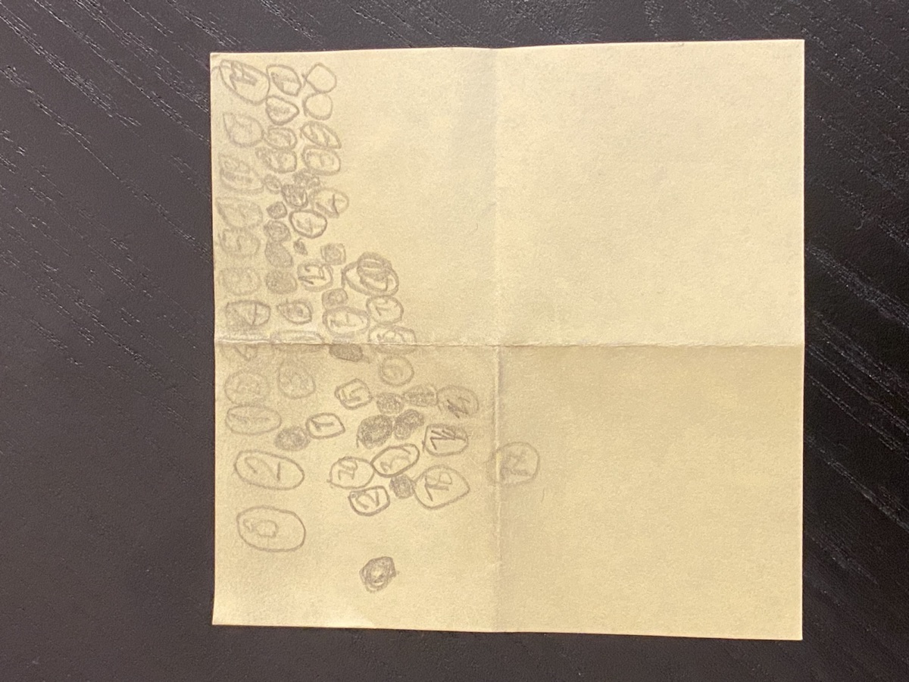
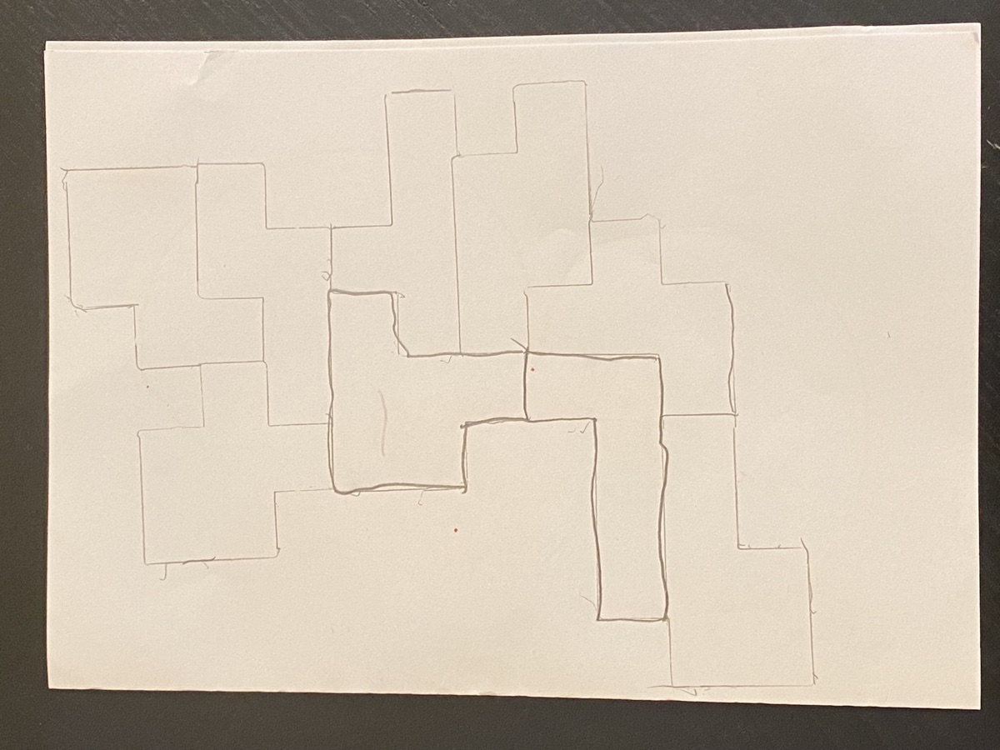

My kids wanted to make their own games. They can't write code yet, but they know exactly what they want. So each of them explained their idea to me out loud and drew a rough sketch on paper. I used Claude Code to help them turn that into a working browser game.

## Dupliziere die Nummern

Numbered circles scattered across the page. Find two circles with the same number and tap them, but stay away from the black stones that wander around.

[Play Dupliziere die Nummern](/public/child19/){:target="_blank"}

## Scribble Slide

Shapes on a sketchbook page. Tap one and it slides the way its arrow points. Clear the whole page before the clock runs out.

[Play Scribble Slide](/public/scribble-slide/){:target="_blank"}

The sketches did most of the design work. Both games keep the hand-drawn pencil look of the paper they started on.
