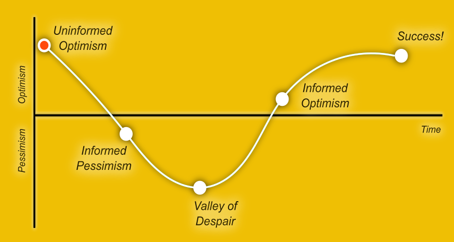

Jedes Stück, das ich verkaufe, ist in Europa von Hand gefertigt. Das hat zum Teil mit meinen Werten zu tun. Ich will europäischen Handwerksbetrieben zum Erfolg verhelfen. Und ich will langlebige Qualität zu Menschen bringen, die lieber einmal für etwas Gutes zahlen, als ständig billigen Ersatz zu kaufen.

Es hat auch praktische Gründe. Wenn ich in Europa bleibe, habe ich eine Versandzone und ein Steuerrecht, mit dem ich mich auseinandersetzen muss. Sonst wären es so viele, wie ich Herkunftsländer hätte.

Im August 2025 habe ich meinen Konzernjob gekündigt, um dieses Geschäft aufzubauen. Seitdem war es aufregend, beängstigend und lehrreich, ungefähr zu gleichen Teilen. Ich schreibe das nach ein paar Monaten, bevor ich auch nur ein einziges Produkt verkauft habe. Hier ist, was ich bisher gelernt habe.

## Der emotionale Zyklus der Veränderung: mehr als ein Schlagwort {#the-emotional-cycle-of-change-more-than-a-buzzword}

Die Idee einer Veränderung finden wir alle toll. In Wirklichkeit ist sie chaotischer. So hat sich der „Emotional Cycle of Change“ bei mir bisher angefühlt:

* **Ahnungsloser Optimismus:** Die Flitterwochen, und ehrlich gesagt bin ich genau da gerade. Alles scheint möglich. Ich bin voller Ideen und Energie und reite auf der ersten Welle der Begeisterung.
* **Informierter Pessimismus:** Die Realität holt mich ein. Die To-do-Liste wird länger, und Zweifel schleichen sich ein. Bin ich dafür wirklich gemacht?
* **Tal der Verzweiflung:** Der härteste Teil. Es geht nur langsam voran, und Aufgeben wirkt verlockend. Hier geben die meisten auf.
* **Informierter Optimismus:** Erste kleine Erfolge zeigen sich. Hier muss ich aus Fehlern lernen und einen Weg nach vorn sehen.
* **Erfolg:** Da bin ich noch nicht. Aber ich weiß jetzt, dass Erfolg ein Prozess ist und kein Moment.

{:style="border-radius: 8px;"}

Wenn du gerade im Tal der Verzweiflung steckst, scheiterst du nicht. Du lernst. Genau dort wächst man.

<small><em>Quelle: Emotional Cycle of Change von Don Kelley und Daryl Conner, erschienen in „The 1979 Annual Handbook For Group Facilitators“. Manche Quellen nennen als ursprünglichen Namen der dritten Phase „Hopeful Realism“ statt „Valley of Despair“. Letzteres ist die verbreitetere Bezeichnung.</em></small>

## Die fünf Grundlagen: Was wirklich zählt {#the-5-fundamentals-what-actually-matters}

Ratschläge gibt es ohne Ende. Ich komme aber immer wieder auf die fünf Grundlagen von Josh Kaufman zurück. Ich stehe noch so weit am Anfang, dass das meiste davon Überlegung ist und kein Beweis. Was wirklich funktioniert, finde ich unterwegs heraus.

**1. Wert schaffen:** Welches echte Problem löse ich? Für mich: Menschen helfen, Produkte zu finden, die zu ihren Werten passen und nicht nur zu ihrem Bedarf.

**2. Marketing:** Wie finden mich die Leute? Meine Annahme: Ehrliche Geschichten und eine aktive Community schlagen große Werbebudgets, gerade am Anfang. Getestet habe ich das noch nicht.

**3. Verkauf:** Aus Interesse Umsatz zu machen ist schwerer, als es aussieht, und ich habe noch keins von beiden. Ich wäge ab zwischen direkter Ansprache und Partnerschaften mit den Handwerksbetrieben selbst. Was davon klappt, wird sich zeigen.

**4. Wert liefern:** Kann ich zuverlässig liefern, was ich verspreche? Die Abläufe dafür baue ich gerade erst auf. Das ist einer der Teile, die ich im Moment am wenigsten verstehe.

**5. Finanzen:** Jeden Euro im Blick behalten. Das ist die einzige Grundlage, um die ich mich schon jetzt kümmern kann, noch bevor überhaupt Geld hereinkommt.

<small><em>Quelle: 5 Parts of Every Business von Josh Kaufman, aus seinem Buch „The Personal MBA“</em></small>

## Aufschieben, das sich als Arbeit tarnt {#my-hard-won-lesson}

Die größte Falle war bisher Aufschieben, das wie Produktivität aussieht. Tabellen, ein Pitch Deck, das Firmenlogo: alles Dinge, die ich in ein, zwei Tagen fertig habe. Das ist leicht im Vergleich zur eigentlichen Aufgabe. Ich muss lernen, ein profitables Geschäft aufzubauen, und mich der Angst stellen, damit zu scheitern.

Ich habe noch kein einziges Produkt verkauft. Und ich weiß: Nichts wird mir mehr beibringen als echte Gespräche mit Kundschaft und echte Produkte, die rausgehen, auch wenn sie noch nicht perfekt sind.

Wenn ich mir eine Gewohnheit antrainieren will, dann diese: die schwere Entscheidung jetzt treffen, damit die späteren leichter werden. Wenn du selbst gründen willst, dann sorg dafür, dass du später nicht bereust, es nie versucht zu haben.

## Und du? {#what-about-you}

Hast du selbst einen großen Sprung gewagt, oder denkst du darüber nach? Was hält dich zurück, und was treibt dich an? Ich freue mich auf deine Geschichte. Vernetz dich mit mir auf LinkedIn, oder schau einfach wieder hier vorbei, für mehr ehrliche Erfahrungen direkt von der Gründungsfront.
