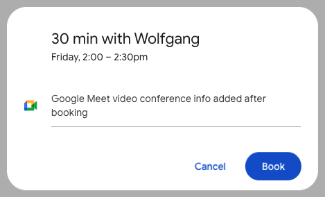

Mein Kalender steht allen offen. Wer will, kann darin ein 30-minütiges Gespräch mit mir buchen. Das klingt vielleicht ein bisschen verrückt. Den Link findest du am Ende dieses Beitrags.

Warum ich das mache? Weil mein Tag, wie deiner wahrscheinlich auch, zu einem Strom aus Chatnachrichten geworden ist. Die fühlten sich eher wie Aufgaben an als wie Gespräche. Paradoxerweise stand all diese Kommunikation echter Verbindung im Weg, genauso wie Kreativität und dem tiefen Fokus, den unsere Arbeit braucht.

Fokus war mir schon immer wichtiger als die falsche Dringlichkeit sofortiger Antworten. Das ist nicht nur eine persönliche Vorliebe. Ich bin überzeugt, dass man so gut baut. Weg von zerstückelten Textnachrichten, hin zu konzentrierten Gesprächen: Das ist der zuverlässigste Weg zurück zu Klarheit und Schwung. Mein öffentlicher Kalender ist mein Bekenntnis dazu.

> **„Ständige Kommunikation steht echter Verbindung paradoxerweise im Weg.“ - [Klick hier, um das auf X zu posten!](https://twitter.com/intent/tweet?text=St%C3%A4ndige+Kommunikation+steht+echter+Verbindung+paradoxerweise+im+Weg.)**

### Was in einer Textwand verloren geht

Du kennst das bestimmt: Eine einfache Frage wächst sich zu einem Dutzend Nachrichten aus, obwohl ein fünfminütiger Anruf sie gelöst hätte. Das ist mehr als lästig. Es ist ein Symptom eines tieferen Problems, mit dem viele Teams bei asynchroner Kommunikation kämpfen. Text nimmt der Zusammenarbeit wichtige menschliche Ebenen weg.

*   **Verborgener Kontext geht verloren:** Im Gespräch kommen die kleinen Details ans Licht, die Fachleute gern vergessen aufzuschreiben. Das ist der Fluch des Wissens: Manches ist für Fachleute so selbstverständlich, dass sie sich gar nicht vorstellen können, dass andere es *nicht* wissen. Ein Gespräch in Echtzeit ist der beste Weg, solche versteckten Annahmen aufzudecken.
*   **Lautes Denken wird abgewürgt:** Wie oft hast du ein Problem gelöst, nur indem du es jemandem erklärt hast? Dieser Effekt heißt im Englischen „Rubber Ducking“, nach der Quietscheente, der man sein Problem erzählt. Im Gespräch passiert er ganz von selbst. Schneller kann Feedback nicht kommen. Statt nervös auf eine Antwort zu warten, kommt man gemeinsam voran, und das gibt Sicherheit.
*   **Gemeinsames Verständnis leidet:** Deshalb stellt das Agile Manifest „Individuen und Interaktionen mehr als Prozesse und Werkzeuge“. Und deshalb ist der „Bus-Faktor“ für mich ein nützliches Gedankenexperiment, das man immer wieder anstellen sollte: Wie viele Leute dürften ausfallen, bevor dem Team wichtiges Wissen fehlt? Wer Kontext bewusst im Gespräch teilt, stärkt das ganze Team.

### Pair Programming: ein Prinzip in der Praxis

Weil ich an direkte Zusammenarbeit glaube, bin ich ein großer Fan von Pair Programming. Dabei machen nicht zwei Leute die Arbeit von einem. Es schafft Raum für etwas zutiefst Menschliches.

Man teilt nicht nur die Lösung, sondern auch das Handwerk, die Werkzeuge und das Bauchgefühl dahinter. Man leidet, fragt, zweifelt, lacht, lernt und feiert zusammen.

Einmal saß ich mit jemandem an einem technischen Problem, das uns in den Wahnsinn trieb. Wir kamen einfach nicht weiter. Dass wir *gemeinsam* gegen diese Wand gelaufen sind, war entscheidend. Wir konnten uns viel schneller eingestehen, dass wir Hilfe brauchen, als wenn wir allein gewesen wären. Der Frust war groß, die Selbstzweifel klein. Wir waren nicht allein. Wir haben gelernt, sind zusammen gewachsen und haben gefeiert, als wir mit Hilfe das Problem endlich gelöst hatten.

Darin liegt der verborgene Wert. Pair Programming schafft psychologische Sicherheit und führt zu besseren Lösungen. Mit jemandem an der Seite fällt es leichter, sich verletzlich zu zeigen und neugierig zu bleiben.

{:width="50%" style="border-radius: 8px;"}
{: style="text-align: center;"}

### Wie eine Gesprächskultur entsteht

Eine gesunde Kommunikationskultur entsteht nicht zufällig. Sie wächst aus Vertrauen und Eigenständigkeit. Eine Führungskraft muss nicht überwachen, wie im Team geredet wird. Ihre Aufgabe ist, ein Umfeld zu schaffen, in dem gute Kommunikation von selbst passiert. Also: Prioritäten klar machen, die richtigen Werkzeuge bereitstellen und dann dem Team zutrauen, das Problem zu lösen. Gute Kommunikation folgt dann ganz von allein, weil es anders nicht geht.

Für Neue im Team hat sich eine Strategie als besonders wirksam erwiesen. Gib ihnen die Verantwortung für eine Aufgabe, bei der sie auf andere zugehen *müssen*, zum Beispiel ein zentrales Stück Dokumentation zu aktualisieren. Dann „nerven“ sie niemanden mit Erfahrung mehr, sondern machen einfach ihren Job. Sie haben einen klaren Auftrag, Kontakte zu knüpfen und zu lernen.

Am Ende läuft alles auf eins hinaus: Lerne die Menschen in deinem Team so gut wie möglich persönlich kennen. Das hilft in jeder Lage. Und es schafft die gute Kommunikation, ohne die großartige gemeinsame Arbeit nicht geht.

### Lass uns reden

Wenn dich dieser Beitrag angesprochen hat und du tiefer einsteigen willst: Mein Kalender ist offen. Jede Woche halte ich mir Zeit frei für konzentrierte 30-minütige Gespräche. Wir können uns über Ideen, Projekte oder Chancen austauschen, im Geschäft, in kreativen Dingen oder bei etwas ganz Neuem.

Wenn du dich vernetzen willst, [buch dir einen Google-Meet-Termin mit mir](https://meet.wteuber.com/).

[{:style="border-radius: 8px;"}](https://meet.wteuber.com/){:target="_blank"}
{: style="text-align: center;"}

-------

**Jetzt bist du dran.** Welches Gespräch schiebst du schon länger vor dir her, das ein kurzer Anruf klären könnte? **Erzähl es mir über die Social-Media-Links unten.**
