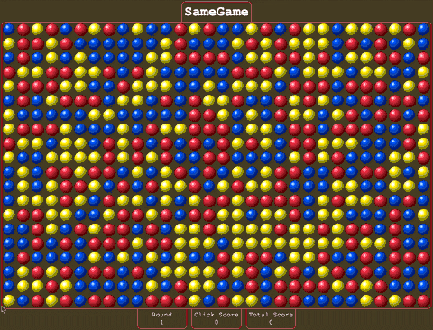

SameGame lernt man in etwa zehn Sekunden. Du hast ein Raster aus bunten Steinen. Klick auf eine Gruppe von zwei oder mehr gleichfarbigen Steinen, die sich berühren, und die Gruppe verschwindet. Alles darüber fällt in die Lücke. Wird eine Spalte ganz leer, rücken die Spalten rechts davon nach links. Große Gruppen bringen viel mehr Punkte als kleine, Geduld zahlt sich also aus.

Spielen kann man auf zwei Ziele, und die ziehen in verschiedene Richtungen. Das eine ist die höchste Punktzahl. Das andere ist ein leeres Brett, für das es meistens einen eigenen Bonus gibt. Das Spiel mit den meisten Punkten lässt oft ein paar Steine übrig. Und wer das Brett leer räumt, verschenkt dafür oft Punkte.

Schwierig wird es nach ein, zwei Minuten. Jeder Klick verschiebt alles darüber, und die Gruppe, die du dir aufheben wolltest, gibt es vielleicht nicht mehr, wenn du so weit bist. Um sicher zu wissen, ob ein Klick gut war, müsstest du jedes Spiel durchspielen, das daraus folgt. Das kann sich niemand leisten. Die Alternative ist, schnell zu schätzen. Wie gut diese Schätzung ist, unterscheidet einen guten Solver von einem schlechten.

Ich habe einen geschrieben, er heißt bitbeam. Auf einem Brett mit 30×20 Feldern und drei Farben, also 600 Steinen, findet er in zwei bis vier Sekunden eine Klickfolge, die alles abräumt. Ein Brett mit 15×10 Feldern dauert höchstens eine Fünftelsekunde. Drei Ideen erklären das meiste davon. Und zwei Dinge, die ich unter „nett zu haben“ abgelegt hatte, waren wichtiger als gedacht. Wenn du es lieber sehen als lesen willst: Ganz unten gibt es [eine Aufnahme, in der ein Bot sieben Bretter abräumt](#so-sieht-es-aus).

Alle Zeiten unten stammen von dem Rechner, auf dem ich bitbeam geschrieben habe: ein Intel i9-9880H mit 8 Kernen und 16 Hardware-Threads, gebaut mit Apple clang und `-O3 -march=native`. Die Brettgrößen wechseln zwischen den Abschnitten, weil ich jede Messung dort gemacht habe, wo sie interessant war. Bei jeder Zahl steht also, zu welchem Brett sie gehört.

## Probier es selbst

Hier ist dasselbe Puzzle in einer Größe, die du von Hand schaffst: sechs Reihen, zwölf Spalten, drei Farben. Klick auf eine Gruppe von zwei oder mehr gleichfarbigen Steinen, die sich berühren, und sie verschwindet. Alles darüber fällt nach, und eine leere Spalte zieht den Rest nach links. Der mittlere Zähler zeigt dir vorab, was die Gruppe unter dem Mauszeiger bringen würde. Große Gruppen sind viel mehr wert als die kleinen, in die man sie hätte zerlegen können. Räum das Brett leer, dann kommt das nächste.



Im Rest dieses Beitrags geht es um das große Brett mit dreißig Spalten und zwanzig Reihen, und darum, es so gut zu spielen, dass es in ein paar Sekunden leer ist.

## Ausprobieren ist keine Option

Auf einem Brett mit 30×20 Feldern gibt es in einer typischen Stellung ein paar Dutzend mögliche Klicks, und ein ganzes Spiel ist etwa fünfzig Klicks lang. Multipliziert man das, kommt eine Zahl mit mehr als hundert Stellen heraus. So viele Atome gibt es im ganzen beobachtbaren Universum nicht.

Alle Möglichkeiten durchzuprobieren scheidet also aus, und zwar nicht nur auf meinem Laptop. Auch keine Maschine, die irgendwer je bauen wird, schafft das. Die eigentliche Aufgabe ist deshalb das Aussortieren: Welche Stellungen wirft man weg, und wie wenig Zeit kann man in diese Entscheidung stecken?

(Angefangen habe ich das Projekt übrigens aus ganz normaler Neugier. Ich habe durch meine alten Repos gescrollt und mich gefragt, wie ich SameGame heute angehen würde und was mir ein moderner Rechner durchgehen lässt.)

## Idee 1: eine Auswahlliste führen

Der Algorithmus heißt [Beam Search](https://en.wikipedia.org/wiki/Beam_search) und ist ziemlich genau das Einfachste, was funktioniert.

Du startest bei der aktuellen Stellung und spielst jeden möglichen Klick. Alle Stellungen, die dabei herauskommen, bewertest du. Die besten 5.000 behältst du, den Rest löschst du. Dann machst du dasselbe von jeder dieser 5.000 aus, behältst die besten 5.000 aus der viel größeren Ausbeute und machst weiter, bis die Spiele zu Ende sind. Fünftausend ist die Breite, mit der bitbeam läuft, wenn der Bot ihn steuert. Die Benchmarks weiter unten nutzen breitere Einstellungen, und bei jedem steht, welche.

Beam Search ist eine abgespeckte Form der Best-First-Suche. Auch Best-First bewertet die erzeugten Stellungen und baut immer die vielversprechendste aus. Sie hebt aber jede Stellung auf, die sie je gesehen hat, falls sie noch einmal zurück muss. Diese Sammlung wächst, solange die Suche läuft. Wie viel Speicher sie braucht, hängt also vom Brett ab und davon, wie gut die Bewertung zufällig funktioniert. Wie viel du gebraucht hast, erfährst du erst, wenn die Suche fertig ist oder der Speicher ausgeht. Beam Search löscht bei jedem Schritt alles unterhalb der Grenze. Die Sammlung bleibt also genau so lang, wie du sie eingestellt hast. Der Speicherbedarf ist dann eine Zahl, die du vorher festlegst, und keine, die die Suche für dich herausfindet.

Der Preis dafür ist Gier. Beam Search wird immer fertig und meldet ein Spiel. Dass es das beste Spiel ist, garantiert aber niemand, und auf einem Brett, das sich abräumen lässt, kann die Suche das leicht verpassen. Mach den Strahl breiter, und der Solver spielt besser und langsamer. Mach ihn schmaler, und es ist umgekehrt. Das ist gar nicht so weit davon entfernt, wie man selbst gut spielt: die Handvoll Züge ansehen, die vielversprechend wirken, den Rest ignorieren und hinnehmen, dass man manchmal etwas übersieht.

Schwierig ist die Frage, was „am besten“ heißt, wenn diese Stellungen bewertet werden. Nach den bisher erzielten Punkten zu sortieren, funktioniert schlecht. Ein Solver, der das tut, nimmt die leichten Punkte früh mit und hinterlässt sich ein Brett voller verstreuter Einzelsteine. Viel besser klappt es, wenn man die Punkte dazurechnet, die noch auf dem Brett liegen. Für jede Gruppe, die gerade da ist, rechnest du aus, was sie bringen würde, wenn du sie so anklickst, wie sie ist. Das alles addierst du zu den bisherigen Punkten. Das ist eine grobe Schätzung, denn jede Gruppe, die du nimmst, verändert die anderen. Aber sie hält die Suche davon ab, zu früh abzukassieren.

Ist das Ziel ein leeres Brett statt einer hohen Punktzahl, braucht die Bewertung noch einen Term. Steine, die zu keiner anklickbaren Gruppe gehören, sind genau die Steine, die zwischen der Stellung und einem leeren Brett stehen. Deshalb kostet jeder davon eine Strafe. Ohne die tauscht die Suche jedes Mal ein abgeräumtes Brett gegen eine weitere fette Gruppe ein.

## Idee 2: Schwerkraft in einer einzigen Instruktion

Der naheliegende Weg, ein Brett im Speicher zu halten, ist eine Zahl pro Stein in einem zweidimensionalen Raster. Eine Gruppe zu finden, heißt dann Flood Fill: von Stein zu Nachbarstein laufen und die passenden einsammeln. Schwerkraft heißt zwei verschachtelte Schleifen, die die Steine einzeln nach unten schieben. Beides ist leicht zu schreiben, und beides ist nicht schnell.

bitbeam speichert eine Spalte als drei 32-Bit-Ganzzahlen. Jeder Stein bekommt in jeder der drei ein Bit, und die drei Bits zusammen ergeben eine Farbe von 0 bis 7. Das deckt die acht Farben ab, die der Solver unterstützt. Eine vierte Zahl merkt sich, wie viele Steine in der Spalte liegen. Steine liegen immer unten in ihrer Spalte, deshalb ist diese Höhe gleichzeitig eine Karte der belegten Felder: Die unteren `colh[x]` Bits sind Steine, alles darüber ist leer, und ein leeres Feld braucht keine eigene Farbe. Diese vier Arrays sind das ganze Brett.

```cpp
using Bits = uint32_t;

struct Board {
  uint8_t w;                          // Spalten, die noch stehen
  uint8_t colh[MAXW];                 // Höhe jeder Spalte
  Bits p0[MAXW], p1[MAXW], p2[MAXW];  // drei Farb-Bitebenen pro Spalte

  Bits occ(int x) const {             // welche Felder belegt sind: die unteren colh Bits
    return static_cast<Bits>((uint64_t{1} << colh[x]) - 1);
  }

  int colorAt(int x, int y) const {   // einen Stein wieder auslesen
    return ((p0[x] >> y) & 1)
         | (((p1[x] >> y) & 1) << 1)
         | (((p2[x] >> y) & 1) << 2);
  }
};
```

Ein Brett mit 30 Spalten kommt auf 90 Ganzzahlen und 30 Höhen, zusammen ein paar hundert Bytes. Jede dieser Ganzzahlen passt in ein einziges CPU-Register. Genau das macht es möglich, dass eine einzige CPU-Instruktion den nächsten Teil der Arbeit erledigt.

[PEXT](https://www.felixcloutier.com/x86/pext), kurz für „parallel bit extract“, nimmt einen Wert und eine Maske, die markiert, welche Bits dich interessieren. Dann schiebt es die markierten Bits in ihrer ursprünglichen Reihenfolge ganz nach unten ins Ergebnis. Eine Instruktion, egal wie viele Bits beteiligt sind. Und jetzt schau dir an, was die Schwerkraft mit einer Spalte macht, wenn einige Steine darin gelöscht werden: Die übrigen behalten ihre Reihenfolge und rutschen nach unten. Das ist genau dieselbe Operation. Eine Gruppe zu entfernen und das Brett sich setzen zu lassen, ist also überhaupt keine Schleife über Steine.

```cpp
// mask[x] sind die Steine der angeklickten Gruppe in Spalte x; lo und hi sind
// die äußerste linke und rechte Spalte, die sie erreicht. pext und popcnt sind
// die CPU-Instruktionen.
for (int x = lo; x <= hi; ++x) {   // nur die Spalten, die die Gruppe berührt
  if (!mask[x]) continue;
  Bits keep = b.occ(x) & ~mask[x]; // die Steine, die den Klick überleben
  b.p0[x] = pext(b.p0[x], keep);   // jede Ebene fällt auf den Spaltenboden,
  b.p1[x] = pext(b.p1[x], keep);   // die Reihenfolge bleibt erhalten,
  b.p2[x] = pext(b.p2[x], keep);   // eine Instruktion pro Ebene
  b.colh[x] = popcnt(keep);        // neue Spaltenhöhe, aus einer Bitzählung
}
```

Drei PEXTs und eine Bitzählung, angewendet auf die zwei oder drei Spalten, die die Gruppe tatsächlich überspannt. Keine verschachtelten Schleifen über das ganze Brett. Die andere Regel des Spiels, dass eine leere Spalte sich schließt und die Spalten rechts davon nachrücken, wird getrennt behandelt. Sie ist billig und selten: Pro verschobener Spalte bewegen sich vier Ganzzahlen, und das nur, wenn eine Spalte ihren letzten Stein verliert.

PEXT hat allerdings Bedingungen. Es ist eine x86-Instruktion, verfügbar seit Intels Haswell-Chips von 2013. Auf AMD-Prozessoren vor Zen 3 war sie in Mikrocode umgesetzt und so langsam, dass normales Schieben schneller war. Deshalb bringt bitbeam eine portable Version mit, die dieselbe Arbeit Bit für Bit erledigt. Die Testsuite schickt 100.000 zufällige Fälle durch beide und prüft, dass sie übereinstimmen.

Das Finden von Gruppen bekommt eine ähnliche Behandlung. Statt Stein für Stein zu laufen, zerlegt der Solver jede Spalte in Abschnitte einer einzigen Farbe. Dann vergleicht er benachbarte Spalten, indem er ihre Bitmuster per XOR verknüpft. Jedes Bit, das im Ergebnis gesetzt bleibt, markiert eine Stelle, an der sich zwei Abschnitte gleicher Farbe berühren. Die gehören also zur selben Gruppe. Die Schleife läuft dann einmal pro Grenze statt einmal pro Stein. Auf einem Brett mit 15×15 Feldern hat das den Verknüpfungsschritt von 3.450 Nanosekunden auf 605 gebracht.

Als Vergleich habe ich [sgbust](https://github.com/chausner/sgbust) genommen, einen anderen SameGame-Solver mit demselben Grundaufbau: Beam Search, ein Hash-Set, um schon gesehene Stellungen zu erkennen, ein Byte pro Feld für das Brett. Er wird über vcpkg gebaut und parallelisiert mit `std::execution::par`, was die Standardbibliothek auf meinem Rechner nicht umsetzt. Es gibt Wege drumherum. Intels TBB zu linken, ist der übliche, auf `seq` auszuweichen ein anderer. So oder so würde die Zahl am Ende genauso viel über unsere beiden Allokatoren und Build-Einstellungen aussagen wie über die Algorithmen. Ich bin deshalb einen anderen Weg gegangen und habe seine drei Kernroutinen in bitbeams Benchmark übertragen. Beide Versionen laufen dann auf demselben Brett mit 20×20 Feldern und fünf Farben, im selben Prozess, abwechselnd, auf einem Thread, jeweils das Beste aus vier Runden.

| | bitbeam | sgbust | Faktor |
|---|---:|---:|---:|
| Gruppen aufzählen | 5.175 ns | 18.410 ns | 3,6× |
| Eine Folgestellung erzeugen | 100 ns | 569 ns | 5,7× |
| Ein Spiel zu Ende spielen | 248 µs | 1.008 µs | 4,1× |

Das Muster hält von 10×10 bis 20×20 und von drei bis sieben Farben: 3,2- bis 4,0-mal schneller beim Aufzählen der Gruppen, 4,8- bis 5,8-mal pro Folgestellung, 3,6- bis 4,1-mal für ein ganzes Spiel. Zwei Dinge sollte man dabei im Kopf behalten. sgbust linkt den Allokator mimalloc, meine Übertragung nicht, und das bremst die Teile, die viel Speicher anfordern. Und das hier sind die kleinen Routinen, die jeder Solver millionenfach ausführt, nicht die beiden Programme von Anfang bis Ende.

Bit-Packing ist deshalb nicht überall eine gute Idee. Ich habe dieselbe Darstellung in einer Ruby-Version des Solvers ausprobiert. Sie war 2,65-mal langsamer als einfache Arrays. Das liegt an der Implementierung, nicht an der Sprache. CRuby hat keine Popcount-Methode auf `Integer` und keine Möglichkeit, ein PEXT auszugeben. Die beiden Instruktionen, die in C++ die Arbeit machen, sind von Ruby aus also gar nicht erreichbar. Und kein Just-in-time-Compiler kann eine Instruktion hervorzaubern, die die Laufzeitumgebung nie erzeugt. Übrig bleibt ein interpretierter Methodenaufruf für jedes Schieben und jede Maske, gegen Array-Zugriffe, die schon in C geschrieben sind. Nichts in der Sprache schließt die beiden Grundoperationen aus. Es gibt sie heute einfach nicht. Und eine Technik, die auf ihnen aufbaut, lohnt sich nur dort, wo Prozessor und Laufzeitumgebung beide mitspielen.

## Idee 3: nicht aufschreiben, was gleich gelöscht wird

Das hat von allem, was ich ausprobiert habe, das Gesamtprogramm am meisten beschleunigt. Und mit Bits hat es nichts zu tun.

Der natürliche Weg, Beam Search zu schreiben, ist, jede Folgestellung komplett aufzubauen: Brett kopieren, Gruppe entfernen, prüfen, ob das Spiel vorbei ist, das Ergebnis serialisieren, hashen und in ein Set einfügen, damit Duplikate auffallen. Dann sortierst du die ganze Ausbeute und wirfst 95 Prozent davon weg. Fast die gesamte Buchführung fließt in Stellungen, die einen Moment später gelöscht werden.

Jeder Kandidat muss trotzdem aufgebaut und bewertet werden, denn nur so erfährt der Solver, was er wert ist. Ablegen muss er ihn aber nicht. Der erste Durchgang speichert sechs Bytes pro Kandidat und sonst nichts:

```cpp
w.objs.push_back(objective(cscore, w.child, w.cmg)); // 4 Bytes: wie gut
w.mvs.push_back(static_cast<uint16_t>(g));           // 2 Bytes: welcher Zug
```

Kein Brett wird in den Speicher kopiert, nichts wird serialisiert, nichts gehasht, nichts landet im Duplikat-Set. Sortiert man diese Sechs-Byte-Stummel, hat man die genaue Grenze. Ein zweiter Durchgang spielt dann nur die Züge darüber noch einmal und speichert die Ergebnisse. Einen Zug noch einmal zu spielen, kostet eine Handvoll PEXTs. Die teuren Schritte, also Serialisieren, Hashen und die Duplikatprüfung, passieren jetzt nur noch für die Überlebenden. Und eine Elternstellung wird einmal ausgepackt, egal wie viele ihrer Kinder es durchgeschafft haben. Die Suche deckt dieselben Stellungen ab und liefert dieselbe Antwort, Byte für Byte. Auf einem Brett mit 15×15 Feldern und einem Strahl von 10.000 ging die Laufzeit von 3.718 Millisekunden auf 1.306 zurück.

## Zweimal dieselbe Antwort

Lass eine parallele Suche zweimal laufen, und du bekommst meistens zwei verschiedene Antworten. Falsch ist keine davon. Sie unterscheiden sich, weil die Grenze zwischen „gut genug zum Behalten“ und „raus“ ein bisschen anders fällt, je nachdem, welcher Thread zuerst da war. Das nervt, wenn etwas kaputtgeht, denn ein Bug, der einmal auftaucht, taucht vielleicht nie wieder auf. Und die Frage, die jede Optimierung aufwirft, nämlich ob sie geholfen hat, lässt sich so gar nicht beantworten.

Die Lösung war, jedem Vergleich in der Suche eine Regel für Gleichstände zu geben. So entscheidet nie das Timing der Threads. Am wichtigsten ist der Vergleich, der darüber entscheidet, wer auf die Auswahlliste kommt.

```cpp
auto better = [](const uint8_t* a, const uint8_t* b) {
  float oa = getObj(a), ob = getObj(b);
  if (oa != ob) return oa > ob;   // die beste Bewertung gewinnt
  return getHash(a) < getHash(b); // Gleichstand: das Brett selbst entscheidet
};
```

Dieselbe Idee zieht sich durch die ganze Suche. Kommen zwei verschiedene Zugfolgen mit derselben Bewertung bei derselben Stellung an, behält der Solver die Folge, die alphabetisch zuerst kommt. Haben zwei fertige Spiele dieselbe Punktzahl, nimmt er das kürzere. Sind auch die Längen gleich, entscheidet wieder das Alphabet.

Das Ergebnis ist eine Ausgabe, die auf 1, 2, 4, 8 und 16 Threads Byte für Byte gleich ist. Die Testsuite prüft das auf zufälligen Brettern. Die parallele Beschleunigung hat das nicht gekostet: Auf einem Brett mit 15×15 Feldern und einem Strahl von 20.000 sind sechzehn Threads immer noch 5,7-mal schneller als einer, auf acht physischen Kernen, wobei das letzte Stück von Hyperthreads kommt. Das ist eine Aussage über die Skalierung, kein Beweis, dass die Ordnungsregeln nichts kosten. Ich habe nie eine nicht deterministische Version gebaut, um sie bei gleicher Thread-Zahl dagegen antreten zu lassen. Sagen kann ich also nur: Die Garantien haben die Skalierung nicht kaputt gemacht.

## Erkennen, wann ein Brett nicht abzuräumen ist

Ob sich ein SameGame-Brett überhaupt leer räumen lässt, ist NP-vollständig. Und das Problem bleibt schwer bei Größen, die viel zu klein aussehen, um schwierig zu sein. [Zwei Farben und zwei Spalten reichen schon](https://erikdemaine.org/papers/Clickomania_MOVES2015/).

Viele Bretter lassen sich nicht abräumen. Eine Beam Search, die auf so einem Brett nach einem leeren Brett sucht, hängt sich nicht auf. Jeder Klick entfernt Steine, also endet jedes Spiel. Aber sie verbraucht ihr ganzes Budget, bevor sie das Scheitern meldet. Ein exakter Beweiser, der weitermacht, bis er so oder so eine Antwort hat, kann noch sehr viel länger laufen.

bitbeam bringt deshalb eine Reihe von Widerlegungen mit: Regeln, die beweisen können, dass ein Brett unmöglich ist, und die nie behaupten, ein Brett sei in Ordnung. Diese Asymmetrie ist Absicht. Eine Regel, die ein lösbares Brett fälschlich ablehnt, würde den Solver Spiele kosten, die er hätte gewinnen können.

- Eine Farbe, von der genau ein Stein übrig ist, lässt sich nie mehr entfernen, denn ein Klick braucht zwei. Das Brett ist tot.
- Eine einzelne Spalte lässt sich genau dann abräumen, wenn ihre Farbfolge von der Grammatik `S → Λ | S S | c S c | c S c S c` erzeugt wird. Das ist ein Ergebnis von [Biedl, Demaine, Demaine, Fleischer, Jacobsen und Munro](https://arxiv.org/abs/cs/0107031). Diese Regel greift ständig, weil Spalten immer wieder zusammenfallen und die Bretter gegen Ende eines Spiels schmal werden.
- [Takes und Kosters](https://liacs.leidenuniv.nl/~takesfw/pdf/samegame.pdf) haben in ihrem Theorem 3 bewiesen: Ein zweifarbiges Brett, mindestens fünf breit und fünf hoch, dessen untere Hälfte ein Schachbrettmuster ist, lässt sich nicht abräumen, egal was darüber liegt. Die Größenbedingung ist wichtig. Auf einem schmalen Brett kann ein Stein, der auf das Schachbrett fällt, mit dem Stein darunter eine Gruppe bilden. Das reißt ein Loch ins Muster, und die Regel wäre falsch.

Jede Regel wird an Tausenden kleiner Bretter gegen eine vollständige Suche geprüft, bevor ich ihr traue. Sie sind allerdings weniger nützlich, als sie aussehen. Im exakten Beweiser senken sie die Zahl der untersuchten Stellungen um den Faktor 1,0 bis 4,4, auf Brettern von 6×6 bis 8×8. Dafür wurden sie geschrieben. In der Beam Search auf lösbaren Brettern kosten sie etwa 8 Prozent und sparen fast nichts. Das ist logisch, sobald man es ausspricht: Eine Widerlegung lohnt sich nur, wenn die Antwort Nein ist, und zufällige Bretter sind fast immer lösbar. Eingeschaltet bleiben sie trotzdem, weil die Bretter, bei denen sie helfen, sonst nie fertig werden.

## Spielt er wirklich besser?

Hier tritt bitbeam gegen den genetischen Algorithmus an, den ich vorher benutzt habe. Getestet habe ich auf sechs zufälligen Brettern mit 15×10 Feldern und drei Farben, und jede Konfiguration sollte das Brett leer räumen. Der genetische Algorithmus ist eine aktuelle Neufassung [des Solvers von 2011](https://github.com/wteuber/samegame_autoplay/tree/master/software/solver/evolutionary), der früher den Bot gesteuert hat. Er läuft auf Ruby 4.0.4. Die erste Zeile ist die Einstellung, mit der der Bot ihn aufruft: eine Population von 10 über 200 Generationen. Die Zeiten sind echte Laufzeit, inklusive Programmstart.

Beam Search war nicht das Erste, was ich ausprobiert habe. Ich hatte ein paar Paper über andere heuristische Ansätze für SameGame gelesen, die evolutionäre Algorithmen nutzten. Das schien einen Blick wert, bevor ich mich festlege. Abgebracht haben mich davon nicht die Argumente in diesen Papern. Es war der Aufwand, den ein evolutionärer Algorithmus bei genau diesem Spiel braucht. Durch Schwerkraft und zusammenfallende Spalten sind zwei Bretter mit ähnlicher Fitness nicht unbedingt nah miteinander verwandt. Ein vielversprechendes Individuum zu mutieren oder zu kreuzen, bringt dich also nicht zuverlässig näher an ein besseres. Beam Search hat dieses Problem nicht. Sie prüft auf jeder Tiefe jeden möglichen Zug direkt und behält die, die schon gut aussehen.

| Solver | Mittlere Punktzahl | Bretter abgeräumt | Mittlere Zeit |
|---|---:|---:|---:|
| Genetischer Algorithmus, ein Kern, kein JIT | 2.031 | 6/6 | 666 ms |
| Genetischer Algorithmus, YJIT und 8 Ractors, Population 64 | 2.613 | 6/6 | 3,3 s |
| Genetischer Algorithmus, YJIT und 8 Ractors, Population 256 | 2.852 | 6/6 | 13,4 s |
| bitbeam, Strahl 5.000, 16 Threads | 3.676 | 6/6 | 136 ms |

Die erste und die letzte Zeile sind die beiden, zwischen denen der Bot tatsächlich wählen würde: bitbeam holt 81 Prozent mehr Punkte und braucht ein Fünftel der Zeit. Die Zeilen dazwischen stehen da, weil der naheliegende Einwand lautet, Ruby sei eben langsam. Ich glaube nicht, dass die Tabelle Langsamkeit zeigt.

Die Bewertungsschleife im Ruby-Solver wurde durch meine Neufassung zwölfmal schneller, bei identischer Arbeit, und mit der Sprache hatte das nichts zu tun. Die Version von 2011 kopierte das Brett für jeden Kandidatenzug mit `Marshal.dump` und `Marshal.load`. Laut Profiler steckten 82 Prozent ihrer Laufzeit in diesen beiden Aufrufen und in der Garbage Collection, die danach aufräumen musste. Ich habe die verschachtelten Arrays durch ein flaches Array ersetzt und die Zwischenpuffer wiederverwendet. Damit sanken 40 Bewertungen eines Bretts mit 15×15 Feldern von 1,75 Sekunden auf 0,14, und die angelegten Objekte von 1,6 Millionen auf 213. Mit YJIT, dem Just-in-time-Compiler von Ruby, sind es 0,054 Sekunden, noch einmal 2,7-mal schneller. Beim Code von 2011 hat YJIT nichts Messbares bewirkt, denn es gab keinen Ruby-Bytecode mehr zu kompilieren. Die eigentliche Arbeit hatte diese Version schon an `Marshal` abgegeben, und das ist C.

Ractors sind der Mechanismus von Ruby, um Code auf mehreren Kernen gleichzeitig laufen zu lassen. Auf acht davon verteilt, sank ein Lauf mit Population 64 von 7,9 auf 3,3 Sekunden, mit genau denselben Ergebnissen wie in der seriellen Version. Diese beiden Features nutzen die mittleren Zeilen, zusammen mit den größeren Populationen, die sie bezahlbar machen. Die zusätzlichen Punkte sind echt, und sie sind teuer: Die letzte dieser Zeilen braucht etwa hundertmal so lange wie bitbeam und landet 22 Prozent darunter.

Der Unterschied liegt also nicht an der Sprache. Ein genetischer Algorithmus probiert ganze Zugfolgen aus und züchtet die weiter, die funktioniert haben. Das ist der Aufwand, auf den ich vorhin gestoßen bin. Beam Search sieht sich auf jeder Tiefe jeden möglichen Zug an und behält die besten paar tausend Stellungen, nach einer Ordnung, die sie begründen kann. Der zweite Ansatz passt besser zu diesem Puzzle, und daran ändern weder ein JIT noch mehr Kerne etwas. Was Ruby hier kostet, ist ein konstanter Faktor, und zwar ein kleinerer, als sein Ruf vermuten lässt.

sgbust fehlt in der Tabelle, und nicht, weil er verloren hat. Aus den Build-Gründen von oben habe ich keine Gesamtzahl für ihn, die etwas über seinen Algorithmus statt über seine Abhängigkeiten aussagt. Der Vergleich auf Routinenebene weiter oben steht deshalb an seiner Stelle.

## So sieht es aus {#so-sieht-es-aus}

Das lässt sich leichter zeigen als beschreiben. Unten spielt ein Bot [die Browserversion von SameGame](/public/samegame){:target="_blank"}, und bitbeam wählt die Züge. Echte Klicks auf einer echten Seite, sieben Bretter mit 30×20 Feldern und drei Farben, eins nach dem anderen abgeräumt.

{:style="border-radius: 8px; display: block; margin: 0 auto;"}

Die Aufnahme läuft in Echtzeit: 74 Sekunden für sieben Bretter, etwa zehn Sekunden pro Brett. Zwei oder drei dieser zehn Sekunden sind die Pause, die du siehst, wenn ein neues Brett erscheint. In der Zeit liest der Bot die Steine vom Bildschirm ab, und bitbeam rechnet das ganze Spiel durch, bevor der erste Klick kommt. Den Rest der Zeit arbeitet der Bot eine Liste von etwa fünfzig Zügen ab, mit sechs bis sieben Klicks pro Sekunde. So viel ergibt seine Zehntelsekunde Wartezeit zwischen den Klicks, wenn man die Mausbewegung mitrechnet. Schnell genug, dass du nicht erkennst, warum eine bestimmte Gruppe gewählt wurde. Langsam genug, um zuzusehen, wie das Brett zerfällt.

## Zum Schluss

Keine der Ideen hier ist neu. Beam Search stammt aus der Spracherkennung der 1970er-Jahre, PEXT steckt seit 2013 in Intel-Prozessoren, und keine Arbeit zu machen, die man gleich wegwirft, ist ein ganz gewöhnlicher Rat aus der Softwareentwicklung. Den Unterschied hat etwas anderes gemacht: sie auf ein einziges Problem anzuwenden und nach jedem Schritt zu messen. Auch den Schritt in Ruby, der alles langsamer gemacht hat und wieder rausgeflogen ist.

Mein Ziel war eng gesteckt: der schnellste allgemeine Solver, den ich auf diesem Rechner zum Laufen bringe, einem Intel-Mac mit PEXT. Alles oben folgt daraus. Ein anderer Chip, eine andere Laufzeitumgebung oder ein anderes Ziel, etwa möglichst wenige Züge statt reiner Geschwindigkeit, würde manche dieser Ideen in andere Richtungen lenken und andere ganz ausschließen.

Die Arbeit am Determinismus hat sich auf eine Art ausgezahlt, die ich nicht geplant hatte. Sobald sich die Ausgabe zwischen zwei Läufen nicht mehr geändert hat, war jede andere Änderung leicht zu beurteilen. Jeder Unterschied im Ergebnis musste ja von der Änderung kommen. Bei den Widerlegungen war es umgekehrt. Sie sind korrekt, es hat Spaß gemacht, sie umzusetzen, und auf den Brettern, die einem wirklich begegnen, bringen sie fast nichts. Keins von beiden stand auf der Liste, als ich angefangen habe.

*Der Bot in der Aufnahme oben ist ein eigenes Programm. Er liest das Brett anhand der Pixel auf dem Bildschirm und spielt, indem er die echte Maus bewegt. Mehr verrate ich hier nicht darüber.*
